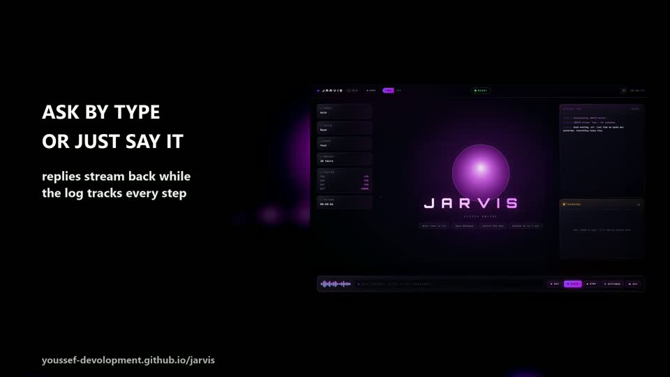
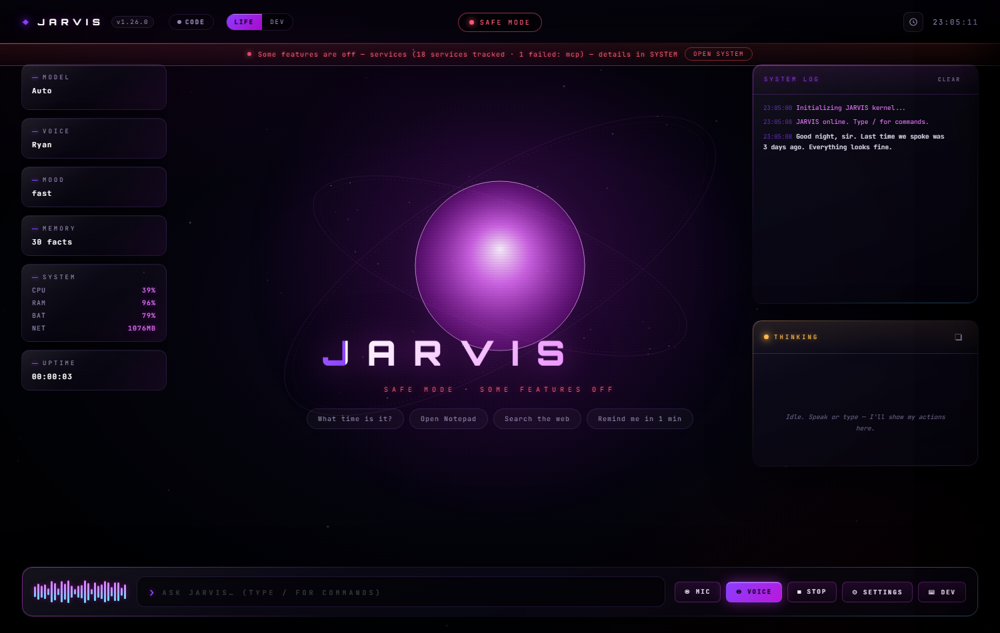
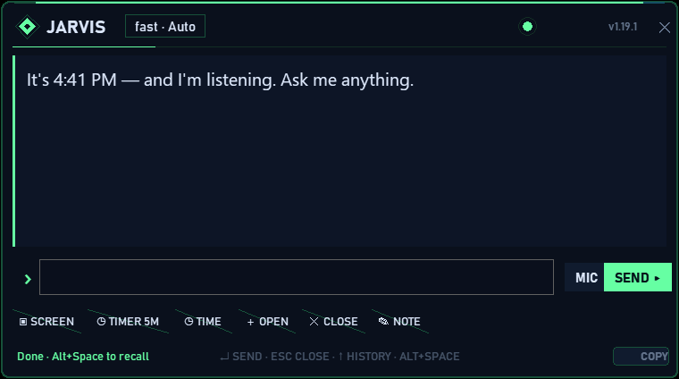

<p align="center">
  
</p>

# JARVIS — talk to your Windows PC. It actually listens.


🌐 **Website:** [youssef-devolopment.github.io/jarvis](https://youssef-devolopment.github.io/jarvis/)
— the live site: features, module ecosystem and full documentation,
always tracking the latest release.

**Promo video (16:9):**
[](https://youssef-devolopment.github.io/jarvis/media/jarvis-promo-16x9.mp4)
— real product footage, served straight from this repo. Click to watch.

## See it in action

| Dashboard | HUD overlay (Alt+Space) |
|---|---|
|  |  |

JARVIS is a voice-first assistant that lives on your Windows machine.
Say or type what you want in plain English — it opens and closes
apps, dictates notes into your Obsidian vault, searches and reads
the web, sets reminders that speak up on their own, and answers
everyday questions instantly. It sits in your tray, and
**Alt+Space** summons it over any window.

It works out of the box with no API key (142 local skills), and
grows into a full AI assistant the moment you add one.

## What it does for you

- **"Open Spotify." "Close Chrome."** — apps open by name (aliases,
  Start Menu, PATH, registry), close gracefully with force only as a
  last resort, and never touch system processes.
- **"Remind me to stand up in 20 minutes."** — the reminder shows in
  the UI and speaks up on its own when the time comes.
- **"Note: idea for the redesign — bolder header."** — captured
  straight into your Obsidian vault (or a local fallback), never
  lost in a chat window.
- **"Search the web for the Artemis mission."** — real search with
  sources, pages fetched and summarized when you ask.
- **"What time is it?"** — instant, spoken; one of 142 local skills
  that work from the first boot.
- **Anything else** — the AI chat (DeepSeek or any OpenAI-compatible
  model) picks up what skills don't cover, streaming answers aloud.

## Who it's for

- Tinkerers who want a real assistant on their own PC — not a
  cloud subscription.
- Voice users and accessibility users who prefer speaking to
  clicking.
- Developers who want a local, inspectable, extensible agent:
  every skill is a small Python file, every endpoint is documented,
  nothing is a black box.

## Install (Windows, 3 steps)

**Step 1 — one line.** Paste into PowerShell *or* cmd, press Enter:

```bat
powershell -c "iex (irm https://raw.githubusercontent.com/Youssef-Devolopment/jarvis/main/setup.ps1)"
```

This clones the repo to `%USERPROFILE%\jarvis`, builds `.venv`,
installs every requirement group + Playwright Chromium, creates
`.env` from the template, then runs an 11-point health check.
Existing files are never touched; already have the repo? Run
`.\setup.ps1` from its folder instead.

**Step 2 — add your key (no files needed).** Start JARVIS once
(`desktop.bat` below), open **Settings → GENERAL**, paste
`DEEPSEEK_API_KEY`, SAVE+TEST. The key is verified live against
your provider (any OpenAI-compatible base URL works), saved to
`.env` with a backup, and chat unlocks immediately. Skip this if
you like — everything below works without one.

**Step 3 — launch.**

```bat
cd %USERPROFILE%\jarvis
desktop.bat         :: tray icon + Ctrl+Alt+J + Alt+Space HUD (recommended)
start.bat           :: console server on http://127.0.0.1:5000
```

Say *"open notepad"*, *"what time is it"*, *"close chrome"*.
Press **Alt+Space** anywhere for the floating HUD. On a fresh
console, one-click starter commands show you a taste of each
capability — time, app control, web search, reminders.

Prefer it manual? `install.bat`, `copy .env.example .env`,
`start.bat` — same result, your hands on every step.

**See it end to end:** [DEMO.md](DEMO.md) is a scripted 90-second
tour — every command in it is verified to work on a clean install.

**Just browsing?** The **[live website](https://youssef-devolopment.github.io/jarvis/)**
tours every feature with the full documentation — nothing to set up,
no install required.

## Core vs optional

| | Needs | You get |
|---|---|---|
| **Core (always on)** | nothing | 142 local skills: time, apps, timers, reminders, notes, math, clipboard, focus mode |
| **AI chat** | `DEEPSEEK_API_KEY` (or any OpenAI-compatible key) | conversations, reasoning, tool use, anything the skills miss |
| **Voice input** | `GROQ_API_KEY` + mic | push-to-talk dictation anywhere |
| **Better web answers** | `BRAVE_API_KEY` or `TAVILY_API_KEY` | higher-tier search results (keyless DDG/Bing fallback works) |
| **Notes to Obsidian** | `OBSIDIAN_VAULT` | notes as Markdown in your vault (SQLite fallback built in) |
| **Todoist sync** | `TODOIST_API_TOKEN` | reminders/tasks mirrored to Todoist |

Full list with defaults: `.env.example`. No key? The startup
summary tells you exactly what works and what a key would add.

## How it works (the short version)

JARVIS is a local Flask server with a tray icon, a global hotkey
and an **Alt+Space** HUD. Your words (voice or text) go through a
**skill router first** — deterministic Python skills answer
instantly and offline. Anything unmatched falls through to the LLM,
which can call 31 built-in tools and any running MCP servers in a
bounded observe-and-repeat loop — up to 15 steps, dead models cooled
out of the rotation for ten minutes, and a guaranteed final answer
when the budget runs out. Multi-part questions fan out to parallel
sub-agents first; state-changing tools park for your allow/deny
instead of running blind. Everything it learns lives in a local
SQLite database on your machine.

Details, diagrams and data flow: [ARCHITECTURE.md](ARCHITECTURE.md).

## Trust and safety

- **Local-first.** Memory, notes, history and keys never leave your
  PC except the LLM calls you configure yourself.
- **No secrets in the repo.** `.env` is gitignored; the setup script
  never asks you to paste keys into files by hand.
- **Honest about its health.** One status pill in the topbar tells
  you READY / ATTENTION / SAFE MODE; the SYSTEM tab shows every
  subsystem; a degraded feature says so instead of failing silently.
- **Safe by default.** Destructive terminal commands are blocked or
  confirmed, closing apps asks first (until you enable auto mode),
  and a RAM watchdog warns before your machine chokes.
- **Survives bad days.** A broken skill can't kill the boot, a dead
  model falls back down a chain, and a missing key only narrows what
  gets answered.

## What it can do (the full list)

- **Talk** — chat bar, mic dictation (Groq), or HUD; skills answer
  first, the LLM fills the gaps (SSE stream, `POST /command`)
- **Open any app** — *"open discord"* resolves aliases, Start Menu,
  PATH and registry; unknown apps get deep-scanned (Program Files /
  LocalAppData / Start Menu / PATH), launched, and kept as a
  permanent instant skill. `GET /api/apps/learned`
- **Close any app** — *"close spotify"*: graceful first (apps may
  prompt to save), force only leftovers, verified gone. System
  processes and JARVIS itself are always refused.
  `POST /api/apps/close`
- **Tidy** — *"tidy"* reports stale temp files, *"tidy confirm"*
  removes them (in-use files skipped); nightly Dream runs clean
  automatically while you're away
- **Auto mode** — turn on *"auto approve skills"* and open/close
  run with zero prompts. Off = voice + toast confirm every time.
- **VSCode + terminal** — open files at line N, run sandboxed
  commands (`code run`, allow-listed folders, destructive commands
  blocked or confirmed), Code-Mode file ops, OpenCode agent tasks
- **Files + Obsidian** — explorer, folders, snippets, layouts;
  notes land in your Obsidian vault (or SQLite fallback),
  `/clip` and `/vault` from chat
- **Add anything** — *"remember https://x as docs"* pins sites
  (`open docs` works after), *"install mcp fetch"*, *"add frob
  as an app"*, *"add a skill that..."* — one router
  (`POST /api/add`) over every installer
- **Web** — tiered search (Tavily AI tier when keyed, Brave, DDG,
  Bing, SearxNG), fetch-and-read pages with Jina fallback,
  summaries, screenshots, WhatsApp / Gmail / Todoist
- **Research** — *"research <topic>"* fans out over live sources
  into a timestamped Markdown report (`docs/research/`), TL;DR
  included, summary remembered; async `POST /api/research`
- **Backup** — *"backup"* zips memory + keys to `logs/backups`
  (last 5 kept); agents that survive dead models via fallback chain
  and ten-minute cooldowns
- **System + voice** — volume, brightness, lock, timers, todos,
  reminders, focus lock, Windows dark/light/transparency, Edge/Piper
  speech (engine pre-warmed at boot), multi-model councils,
  outcome memory, Dream Mode summaries, morning briefing
- **HUD + dashboard** — glassmorphism UI with mood-reactive accent;
  `Alt+Space` opens the command deck anywhere, and the status pill
  reads READY / ATTENTION / SAFE MODE from live health
- **Library (one click)** — Settings → LIBRARY: install any of 18
  bundled skill packs (passwords, calculators, ciphers…) or add any
  of 12 MCP servers (memory, filesystem, fetch, git, playwright…)
  with a single click; packs hot-load validated, MCP entries
  auto-start or tell you which API key to set — and **import your
  own packs as JSON**, with REMOVE / START / STOP per entry
- **Module ecosystem** — Settings → MODULES: a real extensibility
  framework with a `module.json` manifest schema — every module
  declares capabilities, a fixed permission vocabulary, docs and
  examples **before** it may run. Install from a folder or `.zip`
  (validated first, zip-slip and shell-metachar rejection), activate
  / deactivate / uninstall with one click, see installed / active /
  failed states with errors, and dry-run **CHECK** any package before
  installing. Ships 9 real modules (5 computation skills, 4 governed
  MCP integrations) plus skill/MCP author templates — community
  contributors never touch core code ([MODULES.md](MODULES.md))
- **Alerts that reach you** — desktop toast plus a green HUD pulse
  when timers, reminders, research jobs or computer tasks finish
- **Always up to date** — JARVIS checks GitHub at boot and fast-
  forwards itself to the newest version, but never over your local
  edits or unpushed commits; toggle in Settings → GENERAL, manual
  CHECK/UPDATE in Settings → ABOUT (`GET /api/update/check`)
- **System Guard** — a RAM watchdog that warns (once, with the top
  offender named) before the machine chokes, plus *"mic test"*
  pre-flight for dictation; toggle in Settings → GENERAL
- **Health dashboard** — `GET /api/health` reports every subsystem
  in one snapshot; Settings → **SYSTEM** renders it with plain
  verdicts and RESTART/STOP buttons per service
  (`POST /api/services/<name>`), a page-wide banner flags
  warn/degraded states until they clear, ~20s after boot a
  `Health after boot:` line lands in `logs/jarvis.log`, and secrets
  are masked in the log by default
- **Workspace Orchestrator** — *"scaffold a flask project called
  X"* for 7 project kinds (git included), and *"append X to file Y"*
  / *"insert X after anchor"* with a `.bak` every time, allow-listed
  to safe roots (`POST /api/interleave`)
- **n8n Bridge** — automations POST to `/api/webhook/in` to store,
  speak or RUN actions through the skill router (token/localhost
  gated, off by default); *"send to n8n: …"* goes the other way
- **Deep Web Intelligence** — *"docs for X"* reads the real PyPI/
  GitHub docs and briefs them; *"explore X"* fans 4 queries across
  search tiers at once and returns one sourced answer

## Login autostart (power button)

Settings → Autostart **on** (or `POST /autostart/enable`) arms up to
**three independent triggers** so pressing the PC power button always
brings JARVIS up:

1. Startup shortcut `pythonw desktop.py --open`
2. `HKCU\...\CurrentVersion\Run` registry key (no admin needed)
3. Task Scheduler logon task, +15s (created when elevated)

Every boot starts silently, opens JARVIS in a new browser window,
and greets you with system uptime. The single-instance guard makes
a double-fire harmless. Status: `GET /autostart/status`.

## Screenshots

**Alt+Space overlay HUD** — one key away over any window:


> **▶ Demo:** press **Alt+Space** anywhere — the HUD fades in over the
> active window, speak or type, `Esc` (or Alt+Space again) dismisses it.

**▶ Watch it:** [the 30-second promo](https://youssef-devolopment.github.io/jarvis/media/jarvis-promo-16x9.mp4)
— real footage of the HUD, the dashboard and skill packs.

## For builders

```
run.py / server.py / config.py      entry points + settings (.env)
ai/          LLM client, tools, agents, council backends, integrations
skills/      142 @register skills (+ skills/auto_generated/)
library/     one-click catalog: 18 skill packs + 12 MCP entries
             (library/user_catalog.json = your imports, gitignored)
modules/     the module ecosystem: 9 shipped modules (5 skills,
             4 MCP integrations) + _template_skill / _template_mcp
             author templates (modules/state.json = runtime, gitignored)
voice/       Groq mic input, Piper/edge-tts output (Ryan)
memory/      SQLite facts, messages, prefs, outcomes, contacts, …
moods/       personalities, router, escalation levels, classifier
mcp/         client runtime, presets, native stdio MCP server
plugins/     community plugins (validated, isolated, MIT-replaceable)
system/      tray, hotkey, overlay, singleton, autostart, launcher,
             updater, guard (RAM watchdog), health (/api/health
             snapshot), services (one boot registry shared by both
             entry points), startup (first-run boot messaging),
             app_learner (scan + skills), app_close (kill by name)
routes/      Flask blueprints (118 endpoints)
static/ + templates/   web UI (LIFE/DEV modes, 30+ slash commands)
assets/      brand assets: logo banner, icon mark, favicon
             (theme lockups for dark/light in docs/logo-*.svg)
```

- `main` builds green: syntax-check every file + **783 unit tests**
  on Windows runners (`.github/workflows/ci.yml`)
- One broken skill file can never kill the boot: skill modules load
  isolated (failure logged, rest continue), handler crashes fall
  through to the next skill instead of failing the request
- No secrets in the repo — `.env`, `.env.bak`, runtime data and
  browser caches are gitignored; keys live only in your local `.env`
- Community-friendly: MIT license, issue/PR templates,
  `CONTRIBUTING.md`, `CODE_OF_CONDUCT.md`, `SECURITY.md`,
  `ARCHITECTURE.md`, `CHANGELOG.md`, `TESTING.md` (how the repo is
  verified), `DECISIONS.md` (why the architecture is shaped this
  way), `ROADMAP.md` (30/90-day direction), `MANUS.md` (agent-OS
  operator manual: loop, tools, permissions, verification, audit),
  hot-reloadable `plugins/` with a validated template
- AI-continuable: `AGENTS.md` holds the full developer loop
  (layout, commands, constraints, verification) so any coding
  agent can pick up exactly here

## Config

Minimum: `DEEPSEEK_API_KEY` (any OpenAI-compatible base URL).
Optional: `GROQ_API_KEY` (mic), `BRAVE_API_KEY` (search tier),
`OBSIDIAN_VAULT` (notes to Markdown), `TODOIST_API_TOKEN`.
Full list with defaults: `.env.example`.

## Health

```bat
.venv\Scripts\python.exe check.py     :: 11 preflight checks (0=ready, 1=fix core, 2=skills-only)
.venv\Scripts\python.exe -m unittest discover -s tests   :: 783 tests
```

## Links

- **Website & docs:** [youssef-devolopment.github.io/jarvis](https://youssef-devolopment.github.io/jarvis/)
- **Source & issues:** [github.com/Youssef-Devolopment/jarvis](https://github.com/Youssef-Devolopment/jarvis)
- **Module author guide:** [MODULES.md](MODULES.md)
- **90-second demo script:** [DEMO.md](DEMO.md)
- **Changelog:** [CHANGELOG.md](CHANGELOG.md)
